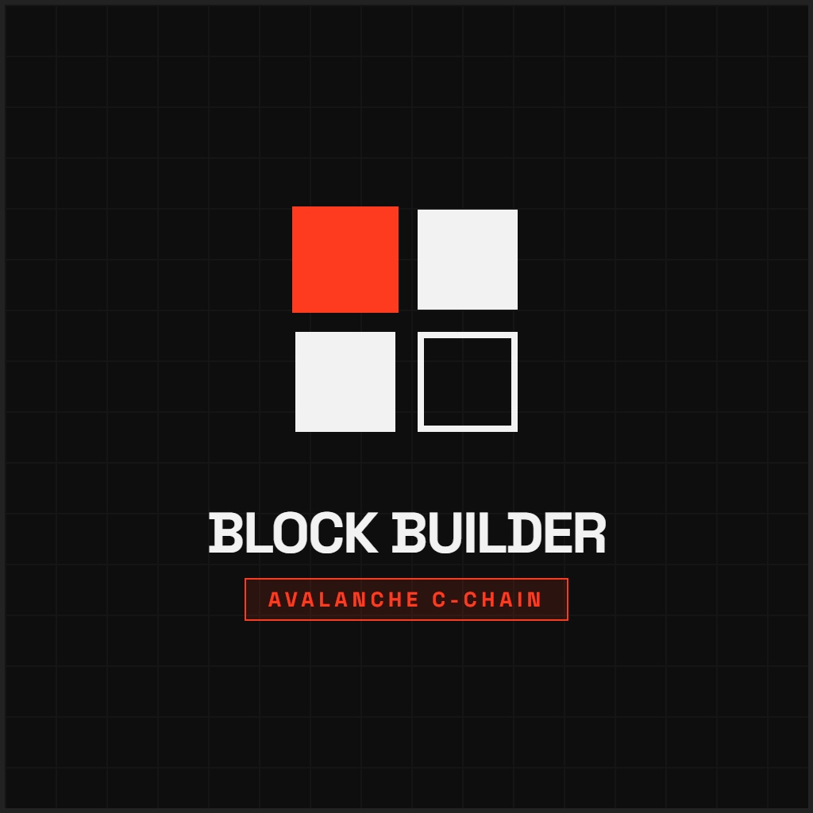
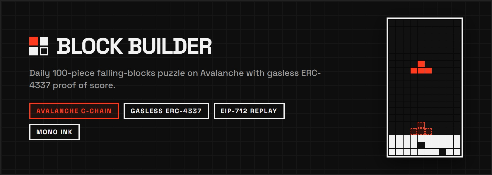
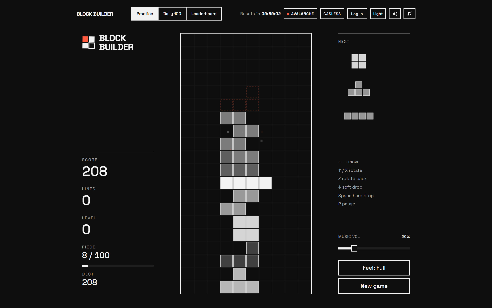
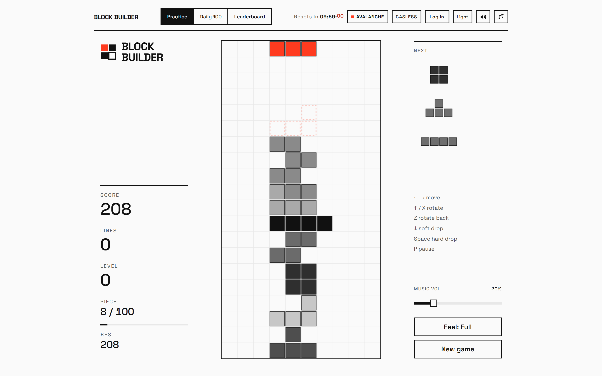
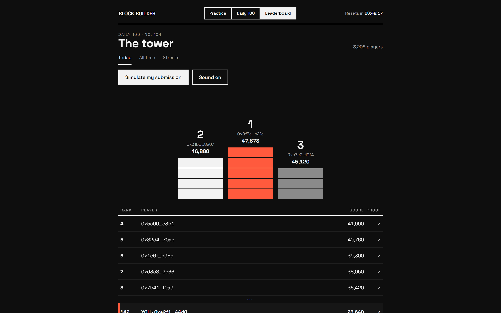
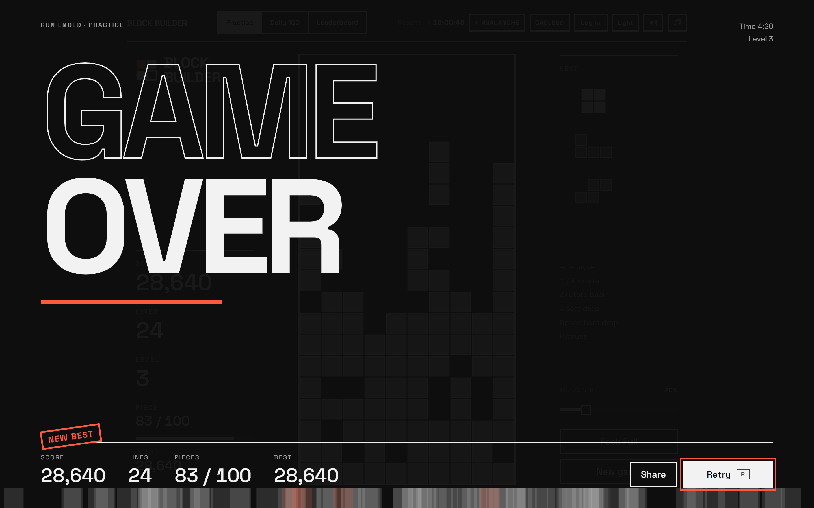

<div align="center">



# Block Builder

**Daily 100-piece competitive falling-blocks puzzle on Avalanche.**  
*Gasless ERC-4337 proof of score, deterministic 60-tick replay, and provably fair commit-reveal seeds.*

[](https://smoothsend-blockbuilder.vercel.app)
[](https://snowtrace.io/address/0x8e3be8a5a13a8fc89d8e04cc07447514f2bf2c40)
[](https://smoothsend.io)
[](LICENSE)

[**Play Live DApp**](https://smoothsend-blockbuilder.vercel.app) &bull; [**View Smart Contract**](https://snowtrace.io/address/0x8e3be8a5a13a8fc89d8e04cc07447514f2bf2c40) &bull; [**Event Details**](https://build.avax.network/events/project-submission?event=3f8d455d-1eb5-425b-b859-4261a0ff8ad6)

<br/>



</div>

---

## 📖 Overview

**Block Builder** is an on-chain competitive puzzle game built for the **Team1 India Speedrun: Build Anything on Avalanche**. 

Every calendar day at `00:00 UTC`, a new cryptographic seed is revealed on-chain. Every player globally receives the **exact same sequence of 100 blocks**. Players have 100 pieces (~3–4 minutes of pure skill) to clear lines, chain combos, and finalize epochs.

### The Problem With Web3 Gaming
1. **Wallet & Gas Friction:** Most on-chain games require users to create an external wallet, bridge funds, buy native gas tokens, and approve popups for every move.
2. **Leaderboard Manipulation:** Traditional Web3 games rely on client-reported scores or naive APIs, making leaderboards vulnerable to bots and memory editing.

### How Block Builder Solves It
- **Zero Crypto Required:** Players log in with an email or social account via **Privy**. An ERC-4337 Smart Contract Wallet (SCW) is generated instantly behind the scenes.
- **100% Gasless on Avalanche:** Transactions are fully sponsored by the **SmoothSend ERC-4337 Paymaster & Bundler**. Players need **0 AVAX** in their wallets.
- **Provably Fair & Anti-Cheat:** Future seeds are committed on-chain in advance. Client scores are completely ignored: the server replays the player's tick-by-tick inputs through a deterministic TypeScript engine and attests with an **EIP-712 signature** that is verified on-chain.

---

## 📸 Screenshots

| Dark Mode Gameplay | Light Mode Gameplay |
|:---:|:---:|
|  |  |

| The Tower Leaderboard | Post-Run On-Chain Verification |
|:---:|:---:|
|  |  |

---

## ⚡ Architecture & Verification Pipeline

```text
  [ Player Client ]               [ Backend Engine ]            [ Avalanche C-Chain ]
         │                                │                                │
 1. Play Daily 100                        │                                │
    Logs: [tick, action]                  │                                │
         │                                │                                │
 2. POST /api/run/submit ───────────────> │                                │
    { runId, log }                        │                                │
                                  3. Deterministic Replay                  │
                                     Re-runs 60-tick sim                   │
                                     Checks anti-cheat                     │
                                          │                                │
                                  4. EIP-712 Sign                          │
                                     Generates ECDSA signature             │
                                          │                                │
 5. Receive Signature <───────────────────┘                                │
         │                                                                 │
 6. Submit UserOp via SmoothSend SDK                                       │
    (Sponsors Gasless Tx via ERC-4337 Paymaster) ────────────────────────> │
                                                                  7. BlockBuilder.sol
                                                                     Verifies signature
                                                                     Records high score
                                                                     Emits RunSubmitted
```

### 1. Cryptographic Seed Commit-Reveal
Future daily seeds are hashed and pre-committed on-chain via `keccak256(abi.encode(day, seed, salt))` using the `commitDays` contract function. At `00:00 UTC`, the seed is revealed. This proves mathematically that the daily piece sequence was never altered after seeing player performance.

### 2. Pure Deterministic Engine (`lib/engine/`)
The simulation engine is built in zero-dependency TypeScript with no DOM, no system `Date`, and no floating-point math:
- Fixed **60 ticks/s** physics simulation.
- 7-bag seeded randomizer using `mulberry32(seed)`.
- Replay function: `replay(seed, log) → { score, lines, epochs, pieces, ticks }`.
- Client and server run the **exact same code**, making game results 100% reproducible.

### 3. Server-Side Replay & EIP-712 Attestation
When a game completes, the server replays the log:
- **Sanity check:** Wall-clock time between `/run/start` and `/run/submit` must be $\ge 90\%$ of `ticks / 60` seconds.
- **Rate check:** Maximum 10 actions per tick.
- The server generates an EIP-712 typed signature for the verified score, line count, epochs, and input log hash.

### 4. Smart Contract (`BlockBuilder.sol`)
Inherits from `DailyBoard.sol` and provides:
- One verified daily run per smart account per UTC calendar day (Sybil resistance).
- Cryptographic verification of the server's EIP-712 signature.
- Streak counters, high-score tracking, and emission of `RunSubmitted` events.

---

## 🎨 "Mono Ink" Design System & Feel

Designed strictly under the **Mono Ink** specification:
- **Palette:** High-contrast monochrome (`#fafafa` / `#0e0e0e`) with thin 2px crisp ink lines, sharp square corners, and exactly **one vibrant accent** (`#ff3b1f` / `#ff5a3d`) reserved for the active piece, ghost outline, and line clears.
- **Typography:** Space Grotesk throughout with tabular numerals.
- **Procedural Audio Synthesizer:** Built on the Web Audio API with zero external audio assets. Features procedural square/saw/triangle waves for moves, hard-drop impacts, combo popups, and line clears.
- **Chiptune Soundtrack:** Integrated background music player with live volume controls, mute toggles (`M`), and theme switching.
- **Game Feel ("Juice"):** Dynamic screen shake with exponential decay, lock delay resets, hit-stops, and game over freeze-frame animations.

---

## 💻 Tech Stack

- **Blockchain:** Avalanche C-Chain (`Chain ID 43114`) & Fuji Testnet (`Chain ID 43113`)
- **Smart Contracts:** Solidity `0.8.20`, Foundry, OpenZeppelin Contracts
- **Account Abstraction:** SmoothSend SDK (`@smoothsend/sdk`), ERC-4337 EntryPoint v0.7
- **Wallet & Authentication:** Privy (`@privy-io/react-auth`)
- **Frontend:** Next.js 14 (App Router), React 18, TypeScript, Vanilla CSS
- **Web3 Libraries:** viem, wagmi
- **Backend / DB:** Next.js Serverless Route Handlers, PostgreSQL (Neon Serverless)
- **Audio:** Web Audio API Procedural Synthesizer

---

## 🚀 Smart Contract Deployments

| Network | Contract | Address | Explorer |
|---|---|---|---|
| **Avalanche C-Chain** | `BlockBuilder.sol` | `0x8e3be8a5a13a8fc89d8e04cc07447514f2bf2c40` | [SnowTrace](https://snowtrace.io/address/0x8e3be8a5a13a8fc89d8e04cc07447514f2bf2c40) |
| **Avalanche Fuji** | `BlockBuilder.sol` | `0x8e3be8a5a13a8fc89d8e04cc07447514f2bf2c40` | [Testnet SnowTrace](https://testnet.snowtrace.io/address/0x8e3be8a5a13a8fc89d8e04cc07447514f2bf2c40) |

---

## 🛠️ Local Development & Setup

### Prerequisites
- Node.js 20+
- npm or pnpm

### 1. Clone the repository
```bash
git clone https://github.com/<your-username>/smoothsend-blockbuilder.git
cd smoothsend-blockbuilder
```

### 2. Install dependencies
```bash
npm install
```

### 3. Configure environment
Copy the example environment file:
```bash
cp .env.example .env.local
```
Fill in your Privy App ID and SmoothSend API keys in `.env.local`.

### 4. Run the development server
```bash
npm run dev
```
Open [http://localhost:3000](http://localhost:3000) with your browser.

### 5. Run tests
```bash
# Run unit & determinism tests
npm test

# Run contract tests
npm run test:contracts
```

---


## 📜 License

This project is licensed under the MIT License — see the [LICENSE](LICENSE) file for details.
